# 🚀 Awesome-Cloud-ML-APIS ☁️🤖

  <b>A curated catalog of the best Cloud ML APIs, serverless GPU inference endpoints, managed model serving platforms, and open-source AI infrastructure frameworks.</b>

---

## 📑 Table of Contents

- [📊 Sector Overview & Market Dynamics](#-sector-overview--market-dynamics)
- [🏢 SaaS & Hosted Platforms](#-saas--hosted-platforms)
- [💻 Open-Source GitHub Projects](#-open-source-github-projects)
- [🏗️ Architectural Patterns & Selection Guide](#️-architectural-patterns--selection-guide)
- [🤝 How to Contribute](#-how-to-contribute)
- [⭐ Star History](#-star-history)
- [💖 Support & Sponsorship](#-support--sponsorship)
- [⚖️ Disclaimer & Terms](#️-disclaimer--terms)

---

## 📊 Sector Overview & Market Dynamics

The global **Cloud AI and Machine Learning API market** is estimated at **$100B–$135B** in 2024–2026, projected to exceed **$700B to $1.3T+ by the early 2030s** at an aggressive 25%–36% CAGR.

The sector exhibits a dual market dynamic:
- 🏛️ **Concentrated at the foundational infrastructure layer (Oligopoly / Winner-Take-Most)**: Dominated by hyperscalers (Microsoft Azure, AWS, Google Cloud) that control raw GPU clusters, global data center footprints, custom silicon (Trainium, TPUs), and enterprise cloud commitments.
- 🧩 **Moderately fragmented across specialized inference and serverless platforms**: High-growth innovators (Modal, Together AI, Baseten, RunPod, Replicate) compete intensely on cold-start latency, developer experience (DX), auto-scaling to zero, and price-per-token economics for open-weights models.

---

## 🏢 SaaS & Hosted Platforms

A complete comparison of top-tier cloud machine learning platforms, serverless inference APIs, and managed endpoint services. Sorted by company scale (market cap / latest valuation in descending order).

| Platform | 🌐 Market Cap / Valuation | 🎯 Primary Focus | 💳 Pricing (Starting Tier) | 🎁 Free Tier / Trial Limits |
| :--- | :--- | :--- | :--- | :--- |
| **[Microsoft Azure ML Endpoints](https://azure.microsoft.com/en-us/products/machine-learning/)** | ~$3.1T Market Cap | Enterprise managed online/batch inference & MLflow governance | From ~$0.096/hr (CPU instances like B2s) / ~$0.90/hr (NC6s GPU) | **$200 credit** (valid for 30 days) + 55+ services free for 12 months |
| **[AWS SageMaker Endpoints](https://aws.amazon.com/sagemaker/)** | ~$1.9T Market Cap | Real-time, asynchronous & serverless ML endpoints on AWS | Serverless inference from ~$0.000020/second (~$0.072/hr) | **Free Tier (First 2 months)**: 250 hours/month of `ml.t2.medium` or `ml.t3.medium` real-time endpoints |
| **[Google Vertex AI Endpoints](https://cloud.google.com/vertex-ai)** | ~$1.8T Market Cap | Unified Google Cloud ML platform with Model Garden & Gemini APIs | Custom prediction nodes from ~$0.056/node-hr (CPU) / ~$0.35/hr (T4 GPU) | **$300 free trial credits** (valid for 90 days) for new GCP accounts |
| **[Modal](https://modal.com/)** | ~$15.75B Valuation | Python-first serverless GPU platform with sub-second cold starts | Container runtime from ~$0.000039/sec (~$0.14/vCPU-hr) + per-sec GPU (T4 at ~$0.59/hr) | **$30/month recurring compute credit** ($0/mo platform fee, 10 concurrent GPUs, 1 TiB egress) |
| **[Baseten](https://baseten.co/)** | ~$13.0B Valuation | Production model serving infrastructure powered by Truss | Pay-as-you-go ($0/mo platform fee); dedicated GPUs from ~$0.45/hr (A10G) | **$30 starting credit** on workspace creation; scales to $2,500+ for startups |
| **[Together AI](https://www.together.ai/)** | ~$8.3B Valuation | Generative AI serverless inference engine & dedicated clusters | Serverless tokens from ~$0.10/1M tokens (Llama 8B); GPUs from ~$0.90/GPU-hr | **No recurring free tier**; requires minimum initial credit purchase ($5–$15 deposit); up to $25k via Startup Program |
| **[Anyscale](https://www.anyscale.com/)** | ~$1.65B Valuation (Acquired) | Managed Ray platform for distributed AI training and serving | Pay-as-you-go compute from ~$0.05/vCPU-hr + cloud provider GPU pass-through | **$100 starting credits** upon sign-up; up to $20,000 for qualifying startups |
| **[RunPod](https://www.runpod.io/)** | ~$1.0B Valuation | Low-cost GPU cloud, serverless workers & pods | Serverless workers from ~$0.0002/sec; Community GPUs from ~$0.27/hr (RTX A5000), ~$0.34/hr (RTX 4090) | **$5–$10 promotional credits** on sign-up (covers ~25–30 hours on entry-level community GPUs) |
| **[Replicate](https://replicate.com/)** | ~$350M Valuation | Cloud API for open-source AI models (Cog container packaging) | Pay-per-second: CPU at ~$0.000100/sec (~$0.36/hr); Nvidia T4 at ~$0.000225/sec (~$0.81/hr) | **Limited free playground runs** on select models without payment method; up to $10 trial credit via partner links |

---

## 💻 Open-Source GitHub Projects

The leading open-source model serving frameworks, inference engines, and local runtimes. Sorted by GitHub star count in descending order.

| Project | ⭐ Stars | 📜 License | 💡 Primary Capabilities & Best Use Case |
| :--- | :--- | :--- | :--- |
| **[Ollama](https://github.com/ollama/ollama)** |  | MIT | **One-command local LLM runner**; effortless setup for local development, edge computing, and offline inference. |
| **[llama.cpp](https://github.com/ggerganov/llama.cpp)** |  | MIT | **Ultra-efficient C/C++ inference runtime** with integer quantization (GGUF, 2-bit to 8-bit) running on plain CPUs and consumer GPUs. |
| **[vLLM](https://github.com/vllm-project/vllm)** |  | Apache-2.0 | **High-throughput LLM serving engine** utilizing PagedAttention, continuous batching, and speculative decoding. Production standard. |
| **[LocalAI](https://github.com/mudler/LocalAI)** |  | MIT | **Self-hosted OpenAI-compatible REST API** drop-in replacement across consumer CPUs and GPUs; supports audio, image generation, and LLMs. |
| **[Ray](https://github.com/ray-project/ray)** |  | Apache-2.0 | **Unified distributed compute engine** and foundation for Ray Serve; handles multi-node scaling, dynamic resource management, and model pipelining. |
| **[SGLang](https://github.com/sgl-project/sglang)** |  | Apache-2.0 | **High-performance structured generation & multi-turn engine** powered by RadixAttention for automatic KV cache sharing across complex prompts. |
| **[MLflow](https://github.com/mlflow/mlflow)** |  | Apache-2.0 | **End-to-end ML lifecycle governance platform**; packages and deploys models across multiple enterprise targets with native artifact tracking. |
| **[Haystack](https://github.com/deepset-ai/haystack)** |  | Apache-2.0 | **End-to-end LLM orchestration framework**; streamlines production RAG pipelines, semantic search, and agentic workflows. |
| **[ONNX Runtime](https://github.com/microsoft/onnxruntime)** |  | MIT | **Cross-platform inference accelerator** optimized for high-performance throughput across CPU, GPU, and specialized hardware accelerators. |
| **[TensorRT](https://github.com/NVIDIA/TensorRT)** |  | Apache-2.0 | **NVIDIA's premier deep learning inference SDK** delivering ultra-low latency and maximum throughput optimization on NVIDIA GPUs. |
| **[OpenLLM](https://github.com/bentoml/OpenLLM)** |  | Apache-2.0 | **Open-source LLM deployment tool** powered by BentoML; one-line command serving open-weights LLMs with OpenAI-compatible APIs. |
| **[Triton Inference Server](https://github.com/triton-inference-server/server)** |  | BSD-3-Clause | **NVIDIA multi-framework serving engine**; orchestrates TensorRT, PyTorch, ONNX, and Python backends with concurrent GPU pipeline execution. |
| **[Text Generation Inference (TGI)](https://github.com/huggingface/text-generation-inference)** |  | Apache-2.0 | **Hugging Face's optimized LLM serving stack**; features tensor parallelism, dynamic batching, and Flash Attention out-of-the-box. |
| **[Xinference](https://github.com/xorbitsai/inference)** |  | Apache-2.0 | **Unified inference platform for multimodal, audio, and language models**; scales across distributed heterogeneous nodes. |
| **[Cog](https://github.com/replicate/cog)** |  | Apache-2.0 | **Reproducible ML container packager**; compiles Python models, CUDA dependencies, and weights into production Docker images. |
| **[BentoML](https://github.com/bentoml/BentoML)** |  | Apache-2.0 | **Unified model packaging & micro-batching serving system**; builds production-grade standard containers for Kubernetes and serverless targets. |
| **[TensorFlow Serving](https://github.com/tensorflow/serving)** |  | Apache-2.0 | **Battle-tested production serving engine for TensorFlow**; high-performance gRPC/REST endpoints with zero-downtime model hot-swapping. |
| **[KServe](https://github.com/kserve/kserve)** |  | Apache-2.0 | **CNCF standard Kubernetes ML inference platform**; provides serverless scaling to zero via Knative, canary rollouts, and explainability. |
| **[Text Embeddings Inference (TEI)](https://github.com/huggingface/text-embeddings-inference)** |  | Apache-2.0 | **Blazing-fast embedding & re-ranking server** (Hugging Face); sub-millisecond vector extraction with token-level dynamic batching. |
| **[Infinity](https://github.com/infiniflow/infinity)** |  | Apache-2.0 | **AI native vector search & inference database**; powers low-latency dense and sparse vector indexing for hybrid RAG applications. |
| **[TorchServe](https://github.com/pytorch/serve)** |  | Apache-2.0 | **Official PyTorch model serving framework** co-developed by AWS and the PyTorch foundation; handles multi-model management and logging. |
| **[LitServe](https://github.com/Lightning-AI/LitServe)** |  | Apache-2.0 | **Minimal, high-speed Python AI inference server** built on FastAPI; achieves up to 2x faster serving than raw FastAPI for custom endpoints. |
| **[LoRAX](https://github.com/predibase/lorax)** |  | Apache-2.0 | **Multi-LoRA inference engine**; serves thousands of fine-tuned adapter weights on top of a single shared base model on 1 GPU. |
| **[LangServe](https://github.com/langchain-ai/langserve)** |  | MIT | **FastAPI-based LangChain serving tool**; exposes LangChain runnables and agents as streaming REST endpoints with built-in playground UI. |
| **[Mosec](https://github.com/mosecorg/mosec)** |  | Apache-2.0 | **Rust-backed model serving framework**; maximizes GPU saturation through high-performance multi-stage dynamic pipelining. |

---

## 🏗️ Architectural Patterns & Selection Guide

- ⚡ **Serverless Scale-to-Zero vs. Persistent Clusters**:
  - Choose **Modal**, **RunPod**, or **Replicate** when workloads are bursty or intermittent; paying only for exact GPU execution seconds prevents idle compute overhead.
  - Choose **Ray Serve**, **vLLM**, or **Triton on Kubernetes** for sustained high-concurrency enterprise workloads where cold-start latency must be eliminated and GPU utilization exceeds 70%.
- 🧠 **LLM High-Concurrency Serving**:
  - Standardize on **vLLM** (PagedAttention, continuous batching) or **SGLang** (RadixAttention for agentic multi-turn prompt caching).
- 🧩 **Heterogeneous & Multi-Modal Models**:
  - Deploy **Triton Inference Server** when coordinating pipelines combining computer vision (TensorRT), embeddings (ONNX), and LLM generation.
- ☸️ **Enterprise Kubernetes Native**:
  - Use **KServe** for multi-tenant clusters requiring Knative autoscaling, Istio service meshes, and canary traffic splitting.

---

## 🤝 How to Contribute

1. Fork this repository 🍴
2. Add or update tools in the table adhering to the schema:
   - For SaaS: include company valuation/revenue, starting tier pricing, and exact free tier/trial limits.
   - For Open-Source: include the GitHub stars social badge linking directly to the repo's stargazers page.
3. Submit a Pull Request 🚀 with concise documentation and verified links.

---

## ⭐ Star History

---

## 💖 Support & Sponsorship

Thank you so much for exploring **Awesome-Cloud-ML-APIS**! ❤️ If this curated list helped you select an inference platform or save infrastructure engineering hours, please consider showing your support:

- ⭐ **Star this repository** to help others discover it on GitHub.
- 🍴 **Fork and contribute** your favorite model serving tools and updates.
- 📢 **Share** with your fellow AI/ML engineers and tech communities.
- ☕ **Sponsor or buy a coffee**: Support ongoing curation and maintenance via the [GitHub Sponsors Dashboard](https://github.com/sponsors/ishandutta2007).

---

## ⚖️ Disclaimer & Terms

- 📌 This directory is an independent community-curated reference list and is not affiliated with any cloud vendor or company listed.
- 🔒 Cloud ML APIs processing user inputs must strictly comply with regional data governance (GDPR, HIPAA, SOC 2, CCPA) and model licensing terms.
- 💡 Performance characteristics, hardware pricing, and API quotas are subject to change by respective providers. Always verify current rates against official vendor portals.

---

  Maintained with ❤️ for ML engineers, AI infrastructure builders, and backend developers seeking reliable, scalable, and data-driven model serving solutions.

